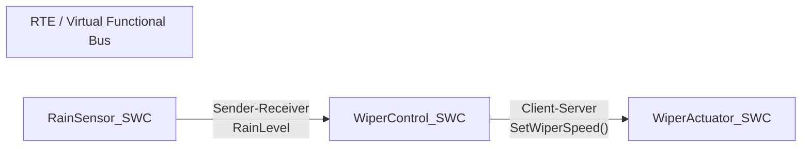

# Contrôle automatique d'essuie-glaces — AUTOSAR Classic & Model-Based Design

Système de contrôle d'essuie-glaces qui adapte la vitesse de balayage à l'intensité de la pluie, conçu selon l'architecture **AUTOSAR Classic** et implémenté de deux façons :

1. **En C, sans outil** : RTE et ordonnanceur écrits à la main pour comprendre les mécanismes internes d'AUTOSAR.
2. **En Model-Based Design** : modélisation MATLAB/Simulink et Stateflow, puis génération automatique du code C AUTOSAR et des fichiers ARXML avec Embedded Coder.

> Projet personnel réalisé pour pratiquer la chaîne de développement logiciel embarqué automobile : architecture, modélisation, génération de code et intégration.

---

## Sommaire

- [Architecture](#architecture)
- [Phase 1 — Implémentation en C](#phase-1--implémentation-en-c)
- [Phase 2 — Model-Based Design](#phase-2--model-based-design)
- [Structure du dépôt](#structure-du-dépôt)
- [Lancer le projet](#lancer-le-projet)
- [Validation](#validation)
- [Difficultés rencontrées](#difficultés-rencontrées)
- [Compétences mises en œuvre](#compétences-mises-en-œuvre)
- [Pistes d'amélioration](#pistes-damélioration)

---

## Architecture

Le système comporte trois composants logiciels (SWC) qui ne se connaissent pas entre eux : toutes les données et requêtes passent par le **RTE** (Runtime Environment), via des ports standards déclarés dans `Rte.h`. C'est le principe du Virtual Functional Bus (VFB).



| Composant | Rôle | Interface | Opération |
|---|---|---|---|
| `RainSensor_SWC` | Fournit l'intensité de pluie | Sender-Receiver (P-Port) | `Rte_Write_RainSensor_RainLevel()` |
| `WiperControl_SWC` | Décide de la vitesse de balayage | S-R (R-Port) et C-S (R-Port) | `Rte_Read_...()` puis `Rte_Call_...()` |
| `WiperActuator_SWC` | Applique la vitesse au moteur | Client-Server (P-Port) | Exécution synchrone de `SetWiperSpeed()` |

---

## Phase 1 — Implémentation en C

Objectif : reproduire à la main l'infrastructure qu'un outil comme DaVinci Configurator génère habituellement, pour comprendre ce qu'il y a sous le capot.

- **RTE simulé** (`Rte_Wiper.c`) : centralise les données et implémente les API standards `Rte_Read`, `Rte_Write` et `Rte_Call`, autour d'un buffer statique protégé qui joue le rôle du VFB.
- **Ordonnanceur** (`main.c`) : simule un OS temps réel de type OSEK/VDX sous Linux, avec une tâche cyclique cadencée qui appelle les runnables dans l'ordre.
- **Compilation** : GCC et Makefile.

---

## Phase 2 — Model-Based Design

Objectif : suivre le processus industriel actuel, où le code applicatif n'est plus écrit à la main mais généré depuis un modèle.

- **Logique de contrôle en Stateflow** : `WiperControl_SWC` est une machine d'états finis. Les actions sont définies à l'entrée des états (par exemple `entry: speed = 1;`) et les transitions par des conditions sur l'intensité de pluie (par exemple `[RainLevel > 50]`). Les données sont typées dans le Symbols Pane : `RainLevel` en entrée, `RequestedSpeed` en sortie.
- **Client-Server en Simulink** :
  - le serveur (`WiperActuator`) est un bloc *Simulink Function* `SetWiperSpeed(RequestedSpeed)`, de visibilité globale à la racine du modèle ;
  - le client (`WiperControl`) l'appelle avec un bloc *Function Caller*.
- **Génération de code** : l'AUTOSAR Component Designer associe les Inports, Outports et fonctions Simulink aux interfaces AUTOSAR, puis Embedded Coder génère les sources `.c` et les descriptions d'architecture `.arxml`.

---

## Structure du dépôt

> À adapter aux noms réels de tes fichiers.

```
.
├── phase1_c/
│   ├── Rte.h               # Déclaration des ports et API RTE
│   ├── Rte_Wiper.c         # RTE simulé (buffer statique, Rte_Read/Write/Call)
│   ├── RainSensor_SWC.c
│   ├── WiperControl_SWC.c
│   ├── WiperActuator_SWC.c
│   ├── main.c              # Ordonnanceur cyclique type OSEK
│   └── Makefile
├── phase2_mbd/
│   ├── models/             # Modèles Simulink / Stateflow (.slx)
│   ├── generated_code/     # Code C généré par Embedded Coder
│   └── arxml/              # Descriptions AUTOSAR générées
├── docs/
│   └── synthese_projet.pdf
└── README.md
```

---

## Lancer le projet

**Phase 1 (C, Linux)**

```bash
cd phase1_c
make
./wiper_sim        # nom de l'exécutable à adapter
```

**Phase 2 (MATLAB/Simulink)**

1. Ouvrir le modèle dans `phase2_mbd/models/`.
2. Lancer la simulation (solveur à pas fixe, 1,0 s).
3. Générer le code : *Apps > AUTOSAR Component Designer*, puis *Generate Code*.

Prérequis : MATLAB, Simulink, Stateflow, Embedded Coder, AUTOSAR Blockset.

---

## Validation

- [x] Simulation des modèles Simulink et Stateflow
- [ ] Génération du code C et des fichiers ARXML
- [ ] Comparaison modèle / code généré (MIL contre SIL)
- [ ] Tests unitaires des runnables

---

## Difficultés rencontrées

- **Conflit de cadencement** entre le solveur à pas fixe et la période de la tâche : résolu en alignant le pas de simulation à 1,0 s.
- **Typage et portée des données** dans Stateflow : déclaration explicite des entrées et sorties dans le Symbols Pane.
- **Modélisation du Client-Server**, moins directe qu'un flux de données : utilisation de *Simulink Function* en visibilité globale et de *Function Caller*.

---

## Compétences mises en œuvre

- **Architecture AUTOSAR Classic** : SWC, RTE, BSW, ports, runnables, interfaces Sender-Receiver et Client-Server, ARXML.
- **Model-Based Design** : MATLAB/Simulink, Stateflow, Embedded Coder, AUTOSAR Component Designer.
- **C embarqué et intégration** : lecture du code généré, compilation GCC et Makefile, interfaçage avec un OS simulé.
- **Débogage** dans un environnement à base de modèles.

---

## Pistes d'amélioration

- Tests back-to-back MIL/SIL et tests unitaires automatisés.
- Vérification MISRA C du code généré.
- Ajout d'un mode « intermittent » et d'une hystérésis sur les seuils de pluie pour éviter les oscillations entre deux vitesses.
- Intégration sur cible réelle (STM32) avec un vrai capteur de pluie.

---

## Auteur

**Bangaly Conte** — Ingénieur en automatique et systèmes embarqués (Master 2 SAM, Université d'Évry Paris-Saclay)
[LinkedIn](https://linkedin.com/in/bangaly-conte-2657a9282)
